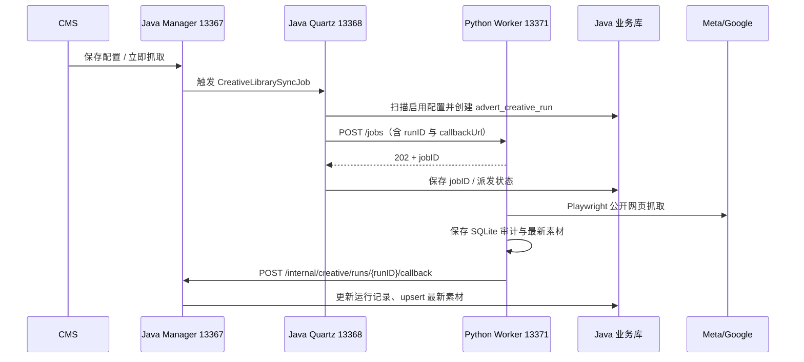

# Python Worker 平台架构

本文按 2026-10-27 当前 Python 与同级 Java 仓库源码核对。源码已存在的链路不等于目标环境已完成数据库初始化或联调验收。

## 1. 职责与依赖

`id-game-distribution-python-workers` 是常驻 Python Worker 宿主。现有 Worker 为 `mock`、Meta Ads Library 公开网页抓取、Google Ads Transparency 公开网页抓取。两种真实 Worker 均使用 Playwright Chromium，不调用 Graph API 或 Google Ads API。

Worker 负责访问平台并标准化结果；宿主负责接收任务、并发限制、执行超时、内存状态、SQLite 审计和 Java 回调。Python 不直接连接 Java 的 MySQL / Redis。本地联调复用 Java 项目已有测试环境，不为 Worker 新建一套业务数据库。

## 2. 当前业务链路

- Manager 的立即抓取复用 Quartz `GET /admin/task/flushData`，指定 Job 类名；不会把选中的 queryID 传给 Quartz。
- `CreativeLibrarySyncJob` 调用 `CreativeWorkerScheduleService.scanAndDispatch()`，扫描全部启用配置，跳过已有 `DISPATCHED` / `RUNNING` 记录的配置。手动触发成功只表示调度接受请求。
- 日常周期来自 Quartz 作业配置，配套 SQL 的建议 Cron 为 `0 0 0/4 * * ?`，默认暂停，实际启用状态以任务库为准。
- 本地默认 Profile 为 `sharding`、`env=dev`。Manager / Quartz 素材数据使用 `sdkgamedb0`，Quartz 作业配置使用 warehouse 数据源 `sdkgametask`。

### 服务地址的实际来源

| 方向 | 当前 Java 代码行为 |
| --- | --- |
| Manager → Quartz | 开发为 `127.0.0.1:13368`，生产为 `https://api-quartz.mar2game.com` |
| Quartz → Python | 固定 `http://127.0.0.1:13371`，所以当前部署需要 Worker 与 Quartz 同机 |
| Python → Manager | Quartz 每次下发显式 `callbackUrl`；开发为 `127.0.0.1:13367`，生产为 `https://api-manager.mar2game.com`，均带 `/internal/creative/runs/{runID}/callback` |

Python 的 `JAVA_CALLBACK_BASE_URL` 仅在任务没有显式 `callbackUrl` 时按 runID 拼接地址。只改 Python `.env` 不能覆盖 Java 已传入的地址，也不能改变 Java 固定的 Worker 目标地址。

## 3. 状态与存储

| 数据 | 当前实现 |
| --- | --- |
| 实时任务 / 后台协程 / 回调地址 | `JobService` 进程内存，重启丢失；`GET /jobs/{jobID}` 不查 SQLite |
| Python 审计 | `DATABASE_PATH`，默认 SQLite `data/worker.db`；启动自动确保表存在 |
| Python 最新素材 | `worker_item`，唯一键 `media + externalAdID`，冲突时更新 |
| Java 查询与运行 | `advert_creative_query` / `advert_creative_run` |
| Java 最新素材 | `advert_creative_item`，按 `media + externalAdID` 更新；不再保存逐次素材历史 |

同一素材通过不同查询抓取时，最新素材行的产品 / 查询上下文随最近结果更新，不是每个 queryID 单独保留一份。任务审计与素材快照是两种记录。

启动入口 `app/__main__.py` 默认加载 `.env`，生产用 `python -m app --env-file .env.production` 显式选择配置；文件不存在时报错，系统环境变量仍优先。入口固定 `workers=1`；生产不启用 reload 或多个进程。并发由进程内 `asyncio.Semaphore` 限制，任务在取得并发名额后才进入 `JOB_TIMEOUT_SECONDS` 执行超时，等待名额的时间不计入该超时。

## 4. 回调的当前边界

Python 发送一次回调，没有自动重试、持久化补发队列或重启恢复。它先保存 SQLite 完成结果，再发送回调；失败时给内存任务补充 `CALLBACK_FAILED`（若已有错误码则保留），不覆盖抓取状态，也不会再次更新 SQLite。因此 `SUCCESS` 或 SQLite 完成记录不能单独证明 Java 已收到结果。

Java 回调 Controller 已使用 `@NoNeedLogin`、`@NoNeedCheckHeader`；Service 校验路径 / 请求体的 runID 一致及合法状态。当前运行记录不存在时会创建记录，用于手工联调，并非严格拒绝未知 runID。正常业务仍应由 Quartz 生成运行记录，queryID 需满足实际数据库外键约束。

回调重复识别使用进程内指纹，Java 重启后不保留；素材唯一键和更新逻辑避免生成重复素材。指纹不是全量 payload 哈希，不能把它描述成可靠的持久化精确去重。运行中的任务因回调失败一直停在 `DISPATCHED` 时，Quartz 会继续跳过该配置，目前没有超时运行自动回收机制。

网页 Worker 的 `newCount` 目前取本次结果条数，`updatedCount` 默认 0；Java 沿用回传计数，未按数据库中的历史素材重新计算真实增量。

## 5. 代理、浏览器与抓取范围

Python API 支持 `proxyProfile` / `proxyRequired`，`ProxyResolver` 从 `PROXY_PROFILE_<名称>` 或默认代理配置解析地址。目前 Java `CreativeWorkerScheduleService` 尚未传这两个字段；且 Python 在未指定 Profile、`proxyRequired=false` 时直接返回无代理，**仅设置 `PROXY_DEFAULT_URL` 不会使当前 Java 派发任务自动走代理**。

现有两个 Worker 用 `chromium.launch(headless=True, proxy=...)` 启动浏览器，未使用持久化登录 Profile，不需要 Xvfb。`ProxyLease.as_playwright_proxy()` 虽能拆分认证字段，但当前 Worker 实际传入的是完整 URL 形式的 `server`，带认证代理的兼容性需要单独验证。自动代理轮换、认证失败分类重试、退避队列尚未实现。

普通任务字段不主动保存代理 URL；异常消息会截取后进入任务 / 回调，尚不能保证第三方异常已经全面脱敏，不应将“任何情况下都不会泄露”描述为已实现能力。

抓取行为：

- Meta 用关键词查询，国家取 `countryCodes` 第一项，缺省为 `ALL`。没有按多个国家分别抓取并合并。
- Google 用 `advertiserName` 或 `keyword` 搜索并选择首个联想广告主；地区先取 `region`，其次 `countryCodes` 第一项，缺省为 `ANYWHERE`。`advertiserID` 当前不控制精准定位。
- `windowStart` / `windowEnd` 是审计上下文，当前网页 Worker 不按它们过滤平台结果。
- `maxResults=0` / 空值 / 缺省表示不设条数上限，但仍有最多 100 轮滚动、连续 3 轮卡片数量不增长和宿主超时限制；不保证完整抓取平台总量。
- Meta 可能 HTTP 403 仍渲染卡片，按实际结果判断；验证挑战可能返回 `WAITING_MANUAL`，普通无结果或浏览器异常也可能是 `FAILED`。
- 保存元数据、预览 / 媒体 URL 和标准化 JSON，不由 Python 下载图片视频到对象存储，也没有自动截图留证链路。

## 6. 扩展与运维入口

新增 Worker 时，在 `app/workers/<name>/` 实现 `BaseWorker`、返回 `WorkerResult`，并在 `app/main.py` 注册；增加有意义的离线回归验证。真实 Cookie、凭据和浏览器状态不能写入仓库。

本地运行和联调见 [README](../README.md) 与[本地验收](本地验收.md)；线上统一用[宝塔 Python 项目面板](部署上线.md)管理。当前内部 API 没有独立鉴权，需要限制调用来源；Java 生产回调走配置在代码中的 HTTPS 域名，须核实其网络访问控制，不能仅凭文档视为已限定内网。
